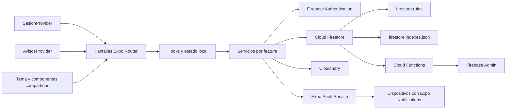

# Guia general del proyecto Eventos

Actualizada el 22 de noviembre de 2026.

Esta guia describe el codigo existente en el repositorio. No confirma que Auth, Firestore, Functions, Hosting, Cloudinary o Expo Push esten desplegados en un proyecto externo. La implementacion real se encuentra principalmente en `frontend/src/`, `backend/firestore.rules`, `backend/functions/src/` y `backend/tests/`.

## 1. Proposito general

Eventos es una aplicacion Expo para Android, iOS y web. Permite:

- al asistente descubrir eventos aprobados, guardarlos como favoritos, seguir organizadores, comprar entradas simuladas, ver el QR, consultar historial, calificar eventos y reportar contenido;
- al organizador solicitar verificacion, crear y administrar eventos, consultar ventas y reportes, responder reportes recibidos y validar entradas por QR;
- al administrador revisar solicitudes de organizadores, aprobar o rechazar eventos, moderar reportes y calificaciones, consultar estadisticas y suspender cuentas o eventos.

El stack principal es Expo Router, React Native, React, TypeScript, Firebase Authentication, Cloud Firestore, Firebase Functions, Cloudinary y Expo Notifications.

## 2. Arquitectura general



### Principios de arquitectura

- `src/app/` contiene rutas y layouts. La ruta no debe concentrar datos o reglas extensas.
- `src/features/<dominio>/` agrupa pantallas, componentes, hooks, servicios y tipos de una funcionalidad.
- `src/compartido/` contiene componentes visuales, tema, navegacion y utilidades reutilizables.
- `src/infraestructura/` inicializa SDK externos.
- `src/config/` lee variables de entorno.
- Los hooks mantienen suscripciones y estados de UI.
- Los servicios son la frontera con Firebase, Cloudinary, Expo o utilidades externas.
- `firestore.rules` es la autorizacion efectiva y debe mantenerse alineada con los servicios.

### Alias y TypeScript

`frontend/tsconfig.json` habilita TypeScript estricto y el alias:

```text
@/ -> frontend/src/
```

Ejemplo: `@/features/auth` apunta a `frontend/src/features/auth`.

## 3. Dependencias y herramientas

### Frontend

| Libreria | Uso |
|---|---|
| `expo`, `expo-router` | ejecucion y navegacion por archivos |
| `react`, `react-native`, `react-dom`, `react-native-web` | UI movil y web |
| `firebase` | Authentication y Firestore |
| `@react-native-google-signin/google-signin` | acceso con Google nativo |
| `@react-native-async-storage/async-storage` | persistencia de Auth en React Native |
| `expo-camera` | escaneo QR |
| `expo-image-picker` | galeria y camara para fotos |
| `expo-file-system` | lectura de imagenes antes de subirlas |
| `expo-notifications` | permisos, tokens y recibo de push |
| `expo-constants` | identificadores EAS y entorno |
| `expo-font`, fuentes Montserrat | tipografia |
| `react-native-safe-area-context` | areas seguras y notch |
| `react-native-qrcode-svg` | generar codigos QR |
| `react-native-svg`, `react-native-reanimated`, `react-native-worklets` | iconos, animacion y graficos |
| `@expo/vector-icons` | iconografia |
| `@react-navigation/bottom-tabs` | pestañas y barra inferior |

### Backend

| Libreria | Uso |
|---|---|
| `firebase-admin` | acceso privilegiado desde Functions |
| `firebase-functions` | triggers y funciones HTTPS callable |
| `typescript` | compilacion a `lib/` |
| `eslint` | lint de Functions |
| `@firebase/rules-unit-testing`, `firebase` | pruebas de reglas |

## 4. Configuracion

### Variables publicas del frontend

Definidas en `frontend/src/config/entorno.ts`:

| Variable | Uso |
|---|---|
| `EXPO_PUBLIC_FIREBASE_API_KEY` | API key Web de Firebase |
| `EXPO_PUBLIC_FIREBASE_AUTH_DOMAIN` | dominio de Auth |
| `EXPO_PUBLIC_FIREBASE_PROJECT_ID` | proyecto Firebase |
| `EXPO_PUBLIC_FIREBASE_STORAGE_BUCKET` | bucket configurado |
| `EXPO_PUBLIC_FIREBASE_MESSAGING_SENDER_ID` | sender ID |
| `EXPO_PUBLIC_FIREBASE_APP_ID` | app Firebase |
| `EXPO_PUBLIC_USAR_EMULADORES` | activa Auth/Firestore Emulator |
| `EXPO_PUBLIC_EMULADOR_HOST` | host alcanzable por el dispositivo |
| `EXPO_PUBLIC_EXIGIR_CORREO_VERIFICADO` | exige email verificado |
| `EXPO_PUBLIC_GOOGLE_WEB_AUTH_CLIENT_ID` o `EXPO_PUBLIC_GOOGLE_WEB_CLIENT_ID` | cliente web de Google Sign-In |
| `EXPO_PUBLIC_CLOUDINARY_CLOUD_NAME` | nube de Cloudinary |
| `EXPO_PUBLIC_CLOUDINARY_PRESET_VERIFICACION` | preset de documentos |
| `EXPO_PUBLIC_CLOUDINARY_PRESET_EVENTOS` | preset de portadas/perfiles |

El secreto de Cloudinary nunca debe incluirse en el cliente. Los presets deben ser seguros segun su configuracion.

El EAS project ID esta en `frontend/app.json` y se usa para obtener el Expo Push Token.

### Emuladores

`backend/firebase.json` configura:

- Auth en `9099`;
- Firestore en `8080`;
- Functions en `5001`;
- Hosting en `5000`;
- UI de emuladores en `4000`.

Para un dispositivo fisico, `EXPO_PUBLIC_EMULADOR_HOST` debe ser la IP LAN de la computadora. `127.0.0.1` apunta al propio telefono.

## 5. Sesion y autenticacion

### Componentes principales

- `src/app/_layout.tsx` carga fuentes, monta `AvisosProvider` y `SesionProvider`.
- `src/features/auth/contexto/SesionProvider.tsx` escucha `onAuthStateChanged`, lee `usuarios/{uid}` y expone el usuario/perfil global.
- `src/features/auth/hooks/useSesion.ts` ofrece el contexto a componentes.
- `src/features/auth/componentes/GuardiaRol.tsx` impide rutas ajenas al rol.
- `src/features/auth/servicios/servicioAuth.ts` realiza registro, login, Google, recuperacion y cambio de contraseña.
- `src/features/auth/servicios/servicioUsuarios.ts` crea y lee perfiles y reserva nombres.

### Flujo de correo y contraseña

1. El usuario completa el formulario.
2. `useRegistro` o `useInicioSesion` valida espacios, formatos y campos obligatorios.
3. El hook llama a `servicioAuth`.
4. Firebase Auth crea o identifica la cuenta.
5. El perfil se lee desde `usuarios/{uid}`.
6. `SesionProvider` actualiza la sesion.
7. `app/index.tsx` redirige segun el rol.

Las acciones criticas tienen guardas contra doble toque y deshabilitan el boton durante la carga.

### Flujo sin internet

Los errores de Auth con `auth/network-request-failed` y los codigos de red se convierten en avisos cotidianos:

- "No hay conexión a internet. Revisa tu red y vuelve a intentarlo."
- "No pudimos conectarnos. Revisa tu conexión a internet e inténtalo de nuevo."

Los errores tecnicos no se muestran al usuario. El estado de carga se libera en `finally`, permitiendo reintentar.

### Registro con Google

Google Sign-In esta cargado de forma perezosa para no romper Expo Go.

- Si ya existe perfil, `SesionProvider` inicia la sesion normal.
- Si no existe perfil, la ruta de acceso muestra `completar-perfil`.
- El perfil se crea usando el correo de Google.
- Si el modulo nativo no existe o no hay configuracion, se muestra un aviso.

### Recuperacion

`useRecuperarContrasenia` valida el correo, bloquea doble envio y envuelve el pedido en estado de carga. El modal informa que, si el correo existe, se envio el enlace.

## 6. Navegacion

### Ruta de arranque

`src/app/index.tsx`:

- sin perfil: `/iniciar-sesion`;
- asistente: `/asistente/explorar`;
- organizador: `/organizador/inicio`;
- administrador: `/administrador/inicio`.

### Rutas de autenticacion

```text
src/app/(auth)/_layout.tsx
src/app/(auth)/iniciar-sesion.tsx
src/app/(auth)/registro.tsx
src/app/(auth)/completar-perfil.tsx
```

El layout detecta perfil pendiente de Google y mantiene a la persona en completar perfil.

### Rol asistente

Pestañas:

```text
inicio/explorar
Mis eventos/entradas
Favoritos
Perfil
```

Rutas secundarias:

- `asistente/evento/[id]`: detalle y compra.
- `asistente/entrada/[id]`: QR de una entrada.
- `asistente/organizador/[id]`: perfil publico.
- historial, calificaciones, reportes y organizadores seguidos.

### Rol organizador

Pestañas:

```text
inicio
mis-eventos
crear
validar-qr
estadisticas
```

Rutas secundarias:

- crear evento;
- editar evento;
- entradas vendidas;
- estadisticas de evento;
- reportes;
- verificacion;
- configuracion/perfil.

### Rol administrador

Pestañas:

```text
inicio
organizadores
eventos
reportes
estadisticas
```

Rutas secundarias:

- moderacion;
- perfil;
- configuracion.

Las rutas incluyen layouts `GuardiaRol` que bloquean accesos del rol incorrecto. Las reglas de Firestore agregan una segunda barrera obligatoria.

## 7. Estructura de carpetas

### Raiz

| Elemento | Responsabilidad |
|---|---|
| `frontend/` | aplicacion Expo |
| `backend/` | Firebase, reglas, indices, Functions, pruebas y Hosting |
| `docs/` | guia general y modelo de datos |
| `estructura.txt` | lista o snapshot historico de estructura |

No deben enviarse logs, exportaciones locales ni secretos.

### Frontend: archivos de configuracion

| Archivo | Responsabilidad |
|---|---|
| `app.json` | nombre, package Android, plugins, iconos y EAS |
| `app.config.js` | google-services segun variable |
| `eas.json` | perfiles de build |
| `package.json` | dependencias y scripts |
| `tsconfig.json` | modo estricto y alias `@/` |
| `expo-env.d.ts` | tipos Expo |
| `google-services.json` | configuracion Android |
| `assets/` | imagenes de interfaz |

### `src/app/`

Archivos con `_layout.tsx` definen la estructura de navegacion. Los archivos planos son rutas exportadas que normalmente reexportan una pantalla de `features/`.

Importante:

- `app/index.tsx` decide la ruta inicial;
- `_layout.tsx` monta proveedores globales;
- `(pestanas)` crea barras inferiores;
- `[id].tsx` y rutas dinamicas reciben parametros con `useLocalSearchParams`;
- `(auth)` agrupa pantallas sin sesion.

### `src/compartido/`

| Carpeta | Responsabilidad |
|---|---|
| `componentes/` | ModalCentrado, botones, campos, encabezados, pestañas, fondo hero y componentes reutilizables |
| `avisos/` | proveedor global de mini-modales para errores, confirmaciones e informacion |
| `navegacion/` | opciones comunes de pestañas |
| `tema/` | colores, medidas, fuentes y exports |
| `utilidades/` | imagen, sanitizacion, barra de estado, selección de archivos y mensajes proximamente |

`ModalCentrado` usa `Modal`, `KeyboardAvoidingView`, `ScrollView`, areas seguras e insets. `AvisosProvider` permite informar o confirmar desde hooks sin depender de `Alert.alert`.

Los botones compartidos aceptan estados de carga y deshabilitado; los modales criticos mantienen botones visibles fuera del area desplazable cuando corresponda.

### `src/config/`

- `entorno.ts`: variables publicas, emuladores y correo verificado.
- `cloudinary.ts`: nombre de nube y presets.

### `src/infraestructura/`

- `firebase/cliente.ts`: crea app Auth/Firestore y persistencia AsyncStorage.
- `firebase/index.ts`: exporta la infraestructura.
- `cloudinary/subirImagen.ts`: conversion base64, timeout, fetch y respuesta.

### `src/features/auth/`

| Parte | Responsabilidad |
|---|---|
| `componentes/` | decoracion, encabezados, selector de fecha/rol, guardia y modales |
| `contexto/` | estado global de sesion |
| `hooks/` | login, registro, Google, recuperacion y ajuste de teclado |
| `pantallas/` | inicio de sesion, registro y completar perfil |
| `servicios/` | Firebase Auth y perfiles |
| `utilidades/` | errores, validaciones y rutas |
| `tipos.ts` | contratos de usuario |

### `src/features/asistente/`

| Parte | Responsabilidad |
|---|---|
| `componentes/` | tarjetas de eventos, compra, QR, favoritos, calificar/reportar y perfil |
| `hooks/` | catalogo, detalle, compra, favoritos, seguimientos, calificaciones y perfil |
| `pantallas/` | explorar, detalle, entradas, favoritos, organizador, historial y perfil |
| `servicios/` | consultas y escrituras Firestore/Cloudinary |
| `utilidades/` | categorias, formato, estados de entrada y tarjeta simulada |
| `tipos.ts` | eventos, entradas, reportes y calificaciones |

### `src/features/organizador/`

| Parte | Responsabilidad |
|---|---|
| `componentes/` | accesos, banner de verificacion, tarjetas y botones |
| `contexto/` | perfil organizador compartido |
| `hooks/` | accion crear, estado de verificacion y resumen |
| `pantallas/` | inicio, eventos y perfil |
| `servicios/` | perfil organizador |

### `src/features/crear-evento/`

Contiene categoria, formulario, campos de fecha/hora, carga de foto, validacion y servicios de crear/editar. Las modificaciones aprobadas siguen las reglas de eventos con o sin ventas.

### `src/features/eventos/` y `gestion-evento/`

`eventos/` comparte estado, tarjeta, formato y consultas del organizador. `gestion-evento/` maneja acciones, eliminacion y hoja inferior.

### `src/features/estadisticas/`

Contiene KPIs, graficas, rendimiento, entradas vendidas, distribucion de estrellas y calculos.

### `src/features/verificacion/`

Contiene formulario, documentos, observaciones, estado de solicitud, hooks y servicio de envio. Las imagenes pasan por Cloudinary y la solicitud se escribe en `solicitudesVerificacion/{uid}`.

### `src/features/validar-qr/`

Contiene permisos de camara, visor, lista de eventos validables, lectura QR, ventana temporal y transaccion para marcar entradas usadas.

### `src/features/administrador/`

| Subdominio | Responsabilidad |
|---|---|
| `eventos/` | revision y aprobacion de eventos/cambios |
| `verificaciones/` | expediente y resolucion de organizadores |
| `reportes/` | moderacion de reportes y calificaciones |
| `moderacion/` | suspension/reactivacion de eventos y cuentas |
| `estadisticas/` | metricas administrativas |
| `componentes/` y `pantallas/` | resumen y UI |

### `src/features/notificaciones/`

- `CampanaAvisos` muestra el badge.
- `useAvisos` escucha avisos personales y avisos colectivos de administradores.
- `servicioNotificaciones` crea, escucha y marca notificaciones.
- `servicioPush` registra Expo Push Tokens, envia Expo Push y procesa el toque.
- `PantallaNotificaciones` permite leer todo o tocar un aviso.
- `tipos.ts` y `presentacion.ts` definen tipos, iconos y colores.

### `src/features/recordatorios/`

Programa recordatorios locales 24 horas y 2 horas antes para eventos favoritos o con entradas. Limpia recordatorios que dejan de aplicar.

### `src/features/configuracion/`

Ayuda, legales, perfil, contraseña, foto, contenido editable y configuracion por rol.

### Otros features

- `perfil/`: perfil generico.
- `reportes-organizador/`: reportes recibidos y respuesta.
- `suspension-organizador/`: aviso de suspension.

## 8. Flujos de datos principales

### Autenticacion

```text
Pantalla -> hook -> servicioAuth -> Firebase Auth
                           |
                           +-> SesionProvider -> obtenerPerfil -> usuarios/{uid}
                                                   |
                                                   +-> Redirect por rol
```

El correo verificado y las cuentas bloqueadas se controlan en `SesionProvider`.

### Catalogo y favoritos

```text
useCatalogo -> onSnapshot(eventos estado=aprobado)
useFavoritos -> onSnapshot/favoritos/{uid_evento}
TarjetaEvento -> servicioFavoritos
```

Las listas manejan estados de carga, error y vacio.

### Creacion y revision de eventos

```text
FormularioEvento -> servicioCrearEvento/EditarEvento
                  -> Cloudinary para portada
                  -> eventos/{id}
                  -> notificacion al administrador

Administrador -> servicioRevisionEventos
               -> actualiza estado/observaciones
               -> notificacion al organizador
```

Las reglas limitan quien publica, revisa o edita.

### Compra

```text
ModalCompra -> useCompra -> servicioEntradas
                         -> transaccion Firestore
                         -> actualiza vendidas
                         -> crea entradas/{uid_evento_numero}
                         -> genera token QR
                         -> aviso al organizador
```

La compra es simulada: no procesa una pasarela real ni guarda datos bancarios.

### QR

```text
PantallaValidarQR -> permiso camara
                  -> selecciona evento
                  -> lee entradaId/eventoId/token
                  -> servicioValidacion
                  -> comprueba ventana y propiedad
                  -> transaccion actualiza usada/usadaEn/validadaPor
```

### Verificacion de organizador

```text
Organizador -> Cloudinary -> solicitudesVerificacion/{uid}
            -> avisarAdministradores
            -> push a tokens de administradores

Administrador -> resolverSolicitud
              -> aprobada/rechazada/correccion_requerida
              -> notificacion al organizador
              -> push al organizador
              -> trigger sincroniza usuarios/{uid}
```

### Notificaciones push y campana

```text
Accion dentro de la app
  -> addDoc(notificaciones)
  -> registrar/consultar tokensPush
  -> POST a Expo Push
  -> dispositivo recibe y guarda ruta/notificacionId

Campana
  -> CampanaAvisos -> useAvisos -> onSnapshot
  -> badge con cantidad no leida
  -> tocar abre /notificaciones
  -> tocar fila marca leida y navega a ruta
  -> tocar push marca leida y navega
```

El push remoto no funciona en Expo Go Android; esta orientado a APK/build de desarrollo o builds posteriores. Denegar permisos no impide usar la app.

## 9. Firestore

### Colecciones actuales

| Coleccion | Uso |
|---|---|
| `usuarios/{uid}` | perfil publico, rol y estado |
| `usuarios/{uid}/privado/perfil` | correo, nacimiento, telefono y datos privados |
| `nombresUsuario/{nombreNormalizado}` | reserva de nombre |
| `solicitudesVerificacion/{uid}` | expedientes de organizador |
| `eventos/{eventoId}` | eventos y revision |
| `entradas/{entradaId}` | boletos, snapshots y QR |
| `favoritos/{uid_evento}` | favoritos |
| `seguidos/{uid_organizador}` | seguimiento |
| `reportes/{uid_evento}` | reportes de asistentes |
| `reportesOrganizador/{id}` | reportes visibles al organizador |
| `calificaciones/{uid_evento}` | calificaciones |
| `notificaciones/{id}` | bandeja |
| `tokensPush/{uid}` | Expo Push Token por cuenta |

Las reglas estan en `backend/firestore.rules`. Las consultas compuestas estan en `backend/firestore.indexes.json`.

La propuesta historica esta en `docs/modelo-datos.md`; el codigo actual puede diferir. Ante cambios, actualizar modelo, reglas, servicios y pruebas juntas.

## 10. UI, modales y resiliencia

### Sistema de avisos

`AvisosProvider` se monta en `_layout.tsx` y expone `mostrarAviso()`.

Soporta:

- aviso simple;
- error;
- exito;
- confirmacion con dos botones;
- accion secundaria;
- cierre y callbacks.

No se usa `Alert.alert` en `frontend/src`.

### Formularios y teclado

Los formularios usan:

- `KeyboardAvoidingView`;
- `ScrollView`;
- `keyboardShouldPersistTaps="handled"`;
- padding inferior suficiente;
- `useSafeAreaInsets`;
- `maxLength`;
- validaciones con `.trim()`;
- filtros numericos.

`ModalEditarPerfil`, compra, reporte, calificacion, contraseñas, revisiones administrativas y modales de contenido siguen este patron.

### Loader y doble toque

Los botones criticos usan `cargando`, `guardando`, `procesando` o refs de bloqueo. Las operaciones finalmente liberan el estado para permitir reintento.

### Orientacion

`app.json` fija orientacion retrato, pero pantallas con ScrollView y modales con insets pueden adaptarse a cambios o tamaños pequeños.

### Estados vacios

Las listas principales muestran mensajes amigables cuando no hay elementos:

- catalogo;
- favoritos;
- entradas;
- historial;
- calificaciones;
- reportes;
- solicitudes;
- notificaciones.

## 11. Cloud Functions

`backend/functions/src/index.ts` exporta:

- `comprarEntradas`;
- `alCambiarSolicitudVerificacion`.

`comprarEntradas.ts` es una callable que valida usuario, evento, cupo y limite por persona. El flujo frontend actual usa una transaccion directa de Firestore y no llama a esta callable.

`alCambiarSolicitudVerificacion.ts` escucha cambios en `solicitudesVerificacion/{uid}` y sincroniza:

- `estadoVerificacion`;
- `estaVerificado`.

No contiene por si sola el envio de notificaciones de verificacion.

## 12. Backend y pruebas

`backend/package.json` ofrece:

```powershell
npm run test:reglas
```

Inicia el emulador de Firestore y ejecuta `backend/tests/reglas.test.mjs`.

`backend/functions/package.json` ofrece:

```powershell
npm run lint
npm run build
npm run serve
npm run deploy
npm run logs
```

El script `crear-admin.cjs` solo esta pensado para emulador por las variables de host configuradas en el proceso.

No lanzar scripts de administracion contra produccion sin un proceso seguro.

## 13. Levantar el proyecto

### Frontend

Desde `frontend/`:

```powershell
npm install
npm start
npm run android
npm run ios
npm run web
```

Crear un archivo local `.env` a partir de `.env.example` o definir las variables requeridas en el entorno.

Para dispositivos fisicos:

- configurar Firebase;
- configurar Cloudinary;
- configurar Google;
- configurar el host LAN si se usan emuladores;
- usar APK/build de desarrollo para probar Expo Push.

### Backend

Desde `backend/`:

```powershell
npm install
npm run test:reglas
```

Desde `backend/functions/`:

```powershell
npm install
npm run lint
npm run build
npm run serve
```

## 14. Convenciones para continuar

1. Crear una ruta en `src/app/` y mover la logica reutilizable a `src/features/<dominio>/`.
2. Usar aliases `@/` y tipos estrictos.
3. Mantener pantallas como composicion y hooks como estado/listeners.
4. Acceder a Firebase desde `servicios/`, no desde componentes o layouts.
5. Usar `AvisosProvider` para mensajes, errores y confirmaciones.
6. Usar `ModalCentrado` o modales adaptados con safe areas y teclado.
7. Proteger doble toque y liberar loaders en `finally`.
8. Validar `.trim()`, limites y datos numericos antes de Firestore.
9. Revisar y actualizar Firestore rules e indices al agregar consultas o colecciones.
10. Agregar pruebas de reglas para nuevos permisos o tipos de aviso.
11. Nunca incluir secretos, API secrets o cuentas locales en la guia o el repositorio.
12. Al cambiar notificaciones, actualizar tipos, presentacion, reglas, push, rutas y listeners juntos.
13. Al cambiar modelos, actualizar `modelo-datos.md` y esta guia.
