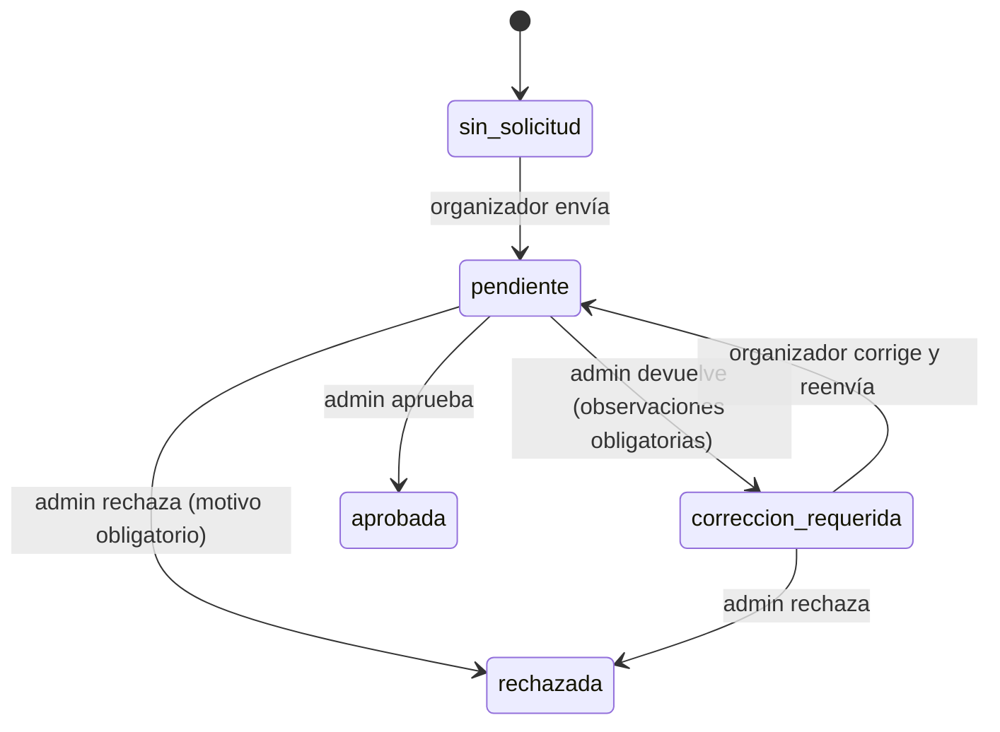
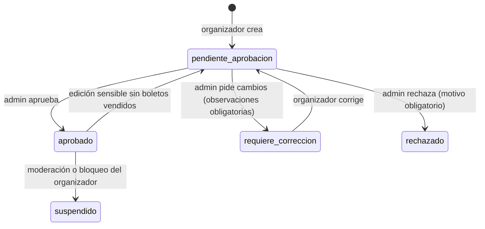
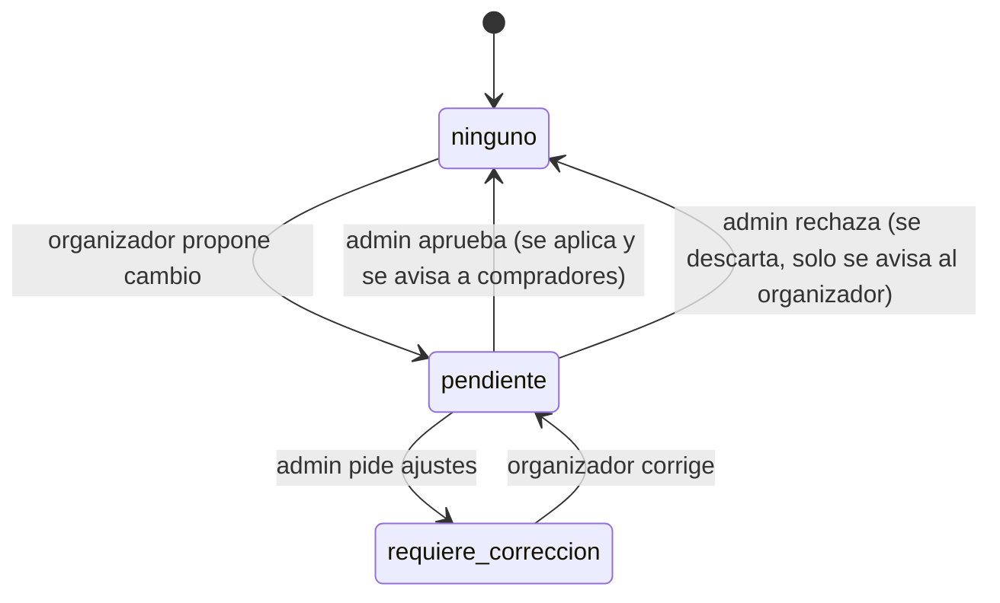

# Modelo de datos: Eventos

> Estado: propuesta v1 con las decisiones D1 a D6 ya tomadas (sección 7), previa a escribir reglas y código. Se basa en las tareas por rol (asistente, organizador, administrador) y en la guía del proyecto anterior (MR-Eventos). Nada de esto está desplegado.

## 1. Principios

1. **El cliente solo escribe lo que le pertenece.** Todo dato derivado (contadores, promedios, estados de verificación, entradas, validación de QR) lo escribe el backend.
2. **Datos privados separados de los públicos.** El perfil público no contiene correo, fecha de nacimiento, teléfono ni tokens.
3. **Fechas como `Timestamp`** de Firestore, no cadenas ISO. El fin del evento se guarda explícito (`fechaFin`), así se evitan los cálculos de cruce de medianoche.
4. **Documentos sensibles aislados.** Los documentos de verificación van a Cloudinary (decisión D4). Su URL solo se guarda en `solicitudesVerificacion`, nunca en documentos públicos. Es un riesgo aceptado, ver sección 8.
5. **Una sola fuente de notificaciones:** los triggers del backend. El cliente nunca crea avisos.
6. **IDs deterministas** donde hay unicidad (`{asistenteId}_{eventoId}`), para que las reglas y las transacciones puedan hacer `get` directo.

## 2. Roles

| Rol | Cómo se obtiene | Qué puede |
|---|---|---|
| `asistente` | Registro | Explorar, favoritos, comprar, ver entradas/QR, calificar, reportar |
| `organizador` | Registro | Solicitar verificación, ver ventas, validar QR, ver reportes de sus eventos. Crear y editar eventos **solo con verificación aprobada** |
| `administrador` | Solo script `crear-admin.js` (nunca desde la app) | Verificar organizadores, dictaminar eventos, moderar, ver métricas |

El rol vive en `usuarios/{uid}.rol`. Las reglas permiten crear el perfil solo con `asistente` u `organizador` y **prohíben modificar `rol`** después. Las reglas leen el rol con `get()` del perfil (1 lectura extra, consistente de inmediato). Más adelante se puede pasar a custom claims.

## 3. Colecciones

### 3.1 `usuarios/{uid}` (perfil público)

| Campo | Tipo | Notas |
|---|---|---|
| `nombreUsuario` | string | Único, ver `nombresUsuario` |
| `nombre`, `apellidos` | string | |
| `rol` | string | `asistente` / `organizador` / `administrador`. Inmutable |
| `fotoUrl` | string? | Cloudinary (imagen pública) |
| `biografia` | string? | |
| `redes` | map? | Enlaces públicos del organizador |
| `ciudad` | string | |
| `estadoVerificacion` | string | `sin_solicitud` / `pendiente` / `correccion_requerida` / `aprobada` / `rechazada`. Solo organizadores. Solo backend |
| `estaVerificado` | bool | Insignia. Solo backend |
| `estadoCuenta` | string | `activa` / `bloqueada`. Solo backend |
| `promedioCalificacion`, `totalCalificaciones` | number | Solo backend |
| `creadoEn` | timestamp | |

Lectura: usuarios autenticados. Escritura del dueño: solo `nombre`, `apellidos`, `fotoUrl`, `biografia`, `redes`, `ciudad`.

### 3.2 `usuarios/{uid}/privado/perfil` (datos privados)

`correo`, `fechaNacimiento`, `telefono`, `expoPushToken`, `motivoBloqueo`.
Lectura: dueño y administrador. Escritura: dueño en `fechaNacimiento`, `telefono`, `expoPushToken`; el resto solo backend.

### 3.3 `nombresUsuario/{nombreNormalizado}`

`{ uid }`. El ID es el nombre en minúsculas y sin espacios. Se reserva en una transacción junto con el perfil. Reglas: `get` autenticado, sin `list`, sin update ni delete.

### 3.4 `solicitudesVerificacion/{uid}`

Una solicitud por organizador (ID = `uid`). Cubre la tarea 2 del organizador y las tareas 1 y 4 del administrador.

| Campo | Tipo | Notas |
|---|---|---|
| `organizadorId` | string | = uid |
| `estado` | string | `pendiente` / `correccion_requerida` / `aprobada` / `rechazada` |
| `telefono` | string | |
| `redes` | array de string | Redes oficiales |
| `descripcionActividad` | string | Tipo de eventos que organiza |
| `rfc` | string? | Opcional |
| `documentos` | map | URL y `publicId` de Cloudinary: `identificacion`, `comprobante` (y `selfie` si se pide) |
| `observaciones` | string? | Obligatorio si el admin devuelve o rechaza |
| `reenvios` | number | |
| `creadaEn`, `actualizadaEn`, `revisadaEn` | timestamp | |
| `revisadaPor` | string? | uid del admin |

Subcolección `historial/{id}`: `{ estado, observaciones, porUid, en }`, solo escribe el backend.
Lectura: titular y administrador. El organizador crea y reenvía (solo hacia `pendiente`); el administrador cambia `estado` y `observaciones`. Un trigger sincroniza `estadoVerificacion` y `estaVerificado` en `usuarios`.
La CLABE del proyecto anterior se elimina: la compra es simulada y no hay motivo para guardar datos bancarios.

### 3.5 `eventos/{eventoId}`

| Campo | Tipo | Notas |
|---|---|---|
| `organizadorId` | string | |
| `organizadorNombre` | string | Snapshot, para que el catálogo funcione sin sesión |
| `organizadorVerificado` | bool | Snapshot para la insignia. Siempre `true`, porque solo organizadores verificados publican (D1) |
| `titulo`, `descripcion` | string | |
| `categoria` | string | Música, Comida, Arte, Deportes, etc. (lista fija en código) |
| `fechaInicio`, `fechaFin` | timestamp | |
| `lugar` | string | Nombre del lugar |
| `direccion` | string | Dirección en Ensenada |
| `ubicacion` | geopoint? | Para el mapa (fase posterior) |
| `precio` | number | `>= 0` |
| `capacidad` | number | `> 0`, nunca menor que `vendidas` |
| `vendidas` | number | Solo backend |
| `imagenUrl`, `imagenPublicId` | string | Cloudinary |
| `estado` | string | Ver sección 4 |
| `observaciones` | string? | Correcciones pedidas |
| `motivoRechazo` | string? | Obligatorio al rechazar |
| `estadoCambio` | string | `ninguno` / `pendiente` / `requiere_correccion`. Ver flujo de cambios en la sección 4 |
| `cambioPropuesto` | map? | Valores nuevos de los campos sensibles (`fechaInicio`, `fechaFin`, `lugar`, `direccion`, `ubicacion`, `precio`, `imagenUrl`, `imagenPublicId`) y `solicitadoEn` |
| `observacionesCambio` | string? | Correcciones pedidas sobre el cambio |
| `promedioCalificacion`, `totalCalificaciones` | number | Solo backend |
| `creadoEn`, `actualizadoEn` | timestamp | |

Lectura: **cualquiera (incluso sin sesión) si `estado == aprobado`**; el organizador dueño y el administrador, en cualquier estado.
Escritura del organizador: crear solo si su `estadoVerificacion` es `aprobada` y con `estado = pendiente_aprobacion`; editar sus campos no sensibles; solo puede mover `estado` hacia `pendiente_aprobacion`. En un evento aprobado con boletos vendidos no puede escribir los campos sensibles directamente: escribe `cambioPropuesto` y `estadoCambio = pendiente`. El administrador cambia `estado`, `observaciones` y `motivoRechazo`. `vendidas` y los promedios solo backend.

### 3.6 `entradas/{entradaId}`

Las crea únicamente la función `comprarEntradas`. Una entrada = un boleto.

| Campo | Tipo | Notas |
|---|---|---|
| `eventoId`, `asistenteId`, `organizadorId` | string | |
| `ordenId` | string | Agrupa los boletos de una misma compra |
| `numero` | number | Posición dentro de la orden |
| `precio` | number | Precio al momento de la compra |
| `pago` | string | `simulado_exitoso` |
| `token` | string | Aleatorio, secreto. Va dentro del QR |
| `usada` | bool | |
| `usadaEn`, `validadaPor` | timestamp?, string? | |
| `eventoTitulo`, `eventoFechaInicio`, `lugar`, `imagenUrl` | | Snapshot para listar sin leer eventos |
| `creadaEn` | timestamp | |

Lectura: el asistente dueño y el organizador dueño del evento. **Escritura desde el cliente: ninguna.**
Contenido del QR: `entradaId` + `eventoId` + `token`. Límite de boletos por usuario: constante en el backend (propuesta: 5 por evento).

### 3.7 `favoritos/{asistenteId_eventoId}`

`{ asistenteId, eventoId, creadoEn }`. El asistente crea y borra los suyos. Para mostrar la lista se leen los eventos por ID.

### 3.8 `reportes/{asistenteId_eventoId}`

Un reporte por asistente y evento.

| Campo | Notas |
|---|---|
| `eventoId`, `organizadorId`, `reportanteId` | |
| `eventoTitulo` | Snapshot |
| `motivo` | `informacion_falsa` / `spam` / `fraude` / `contenido_inapropiado` / `otro` |
| `descripcion` | Obligatoria |
| `estado` | `pendiente_moderacion` / `cerrado` |
| `accion` | `desactivar_evento` / `bloquear_usuario` / `desestimar_reporte` |
| `notaAdmin`, `creadoEn`, `cerradoEn`, `cerradoPor` | |

Lectura: autor y administrador. El asistente solo crea. El administrador cierra el caso a través de una función callable, porque la acción tiene efectos (suspender evento o bloquear cuenta). La severidad se deriva del `motivo` con una tabla constante, y el conteo por evento se agrupa en el panel.

### 3.9 `reportesOrganizador/{reporteId}`

Copia **sin identidad del reportante**, creada por trigger. Cubre la tarea 8 del organizador.
`eventoId`, `organizadorId`, `motivo`, `descripcion`, `estado`, `respuestaOrganizador`, `creadoEn`, `respondidoEn`.
Lectura: organizador dueño y administrador. El organizador solo escribe `respuestaOrganizador`.

### 3.10 `calificaciones/{asistenteId_eventoId}`

`eventoId`, `organizadorId`, `asistenteId`, `asistenteNombreUsuario`, `estrellas` (1 a 5), `comentario?`, `oculta`, `creadaEn`, `actualizadaEn`.
Lectura: autenticados (las ocultas, solo administrador). **Escritura vía callable `calificarEvento`**, que valida que el evento ya terminó y que el asistente tiene una entrada. El administrador alterna `oculta`. Un trigger recalcula promedios del evento y del organizador con una consulta de agregación, ignorando las ocultas.

### 3.11 `notificaciones/{id}`

`destinatarioId`, `tipo`, `titulo`, `cuerpo`, `datos` (map, ej. `{ eventoId }`), `leida`, `creadaEn`.
Solo las crea el backend. El destinatario lee, marca `leida` y borra las suyas.

### Fuera de la v1

- **Seguidores** (`seguidores/{asistenteId_organizadorId}`): no aparece en ninguna tarea. Se agrega después si se quiere.
- **Cola `mail`**: los correos de verificación y recuperación los envía Firebase Auth. No se necesita.
- **Métricas del administrador**: se calculan con consultas `count()` sobre `usuarios`, `eventos` y `entradas`, sin documento de contadores que pueda desincronizarse.

## 4. Estados

### Verificación del organizador

### Evento

Solo `aprobado` es visible al público. Un evento `suspendido` desaparece del catálogo de inmediato.

### Cambios sobre un evento aprobado (D2)

Campos sensibles: fecha de inicio y fin, lugar, dirección, ubicación, precio e imagen.

- **Sin boletos vendidos:** el evento vuelve a `pendiente_aprobacion` y deja de ser visible hasta que el admin lo apruebe, como un evento nuevo.
- **Con boletos vendidos:** el evento **sigue aprobado y visible con los datos actuales**. El cambio se guarda en `cambioPropuesto` con `estadoCambio = pendiente` y pasa a revisión. Los asistentes **no se enteran todavía**.

Al aprobar, la función `dictaminarCambioEvento` aplica los valores al evento, actualiza el snapshot de las entradas ya emitidas y notifica a cada